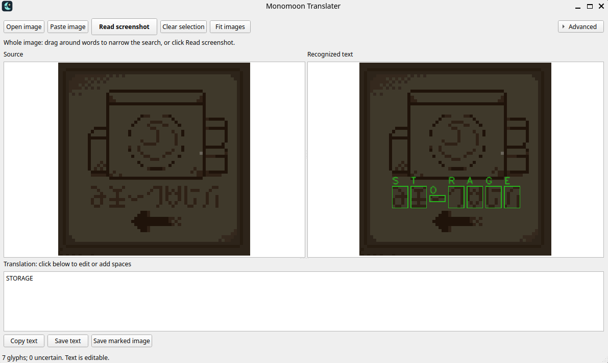

# Monomoon Translator

An unofficial community desktop tool for reading Monomoon screenshots and teaching other fictional alphabets. It matches taught glyph shapes to letters, numbers, and punctuation, then gives you editable text. The included Monomoon key contains **A–Z only**; numbers and punctuation must be taught from a known key before they can be read.

**[Download for Windows](https://github.com/evanjrizzo/monomoon-translator/releases/latest/download/Monomoon-Translator-Windows-x64.zip)** · **[Download for Linux](https://github.com/evanjrizzo/monomoon-translator/releases/latest/download/Monomoon-Translator-Linux-x64.tar.gz)** · [All releases and checksums](https://github.com/evanjrizzo/monomoon-translator/releases/latest)



**AI disclosure:** this project was developed with substantial assistance from **OpenAI Codex**, including implementation, documentation, packaging, and automated tests. Recognition itself uses local OpenCV template matching. It does not use a generative AI model, online OCR service, account, or API key.

This is a community project, not an official game tool or an endorsed translation. Review the output before relying on it or sharing a translation.

## Windows

1. Download **Monomoon-Translator-Windows-x64.zip** from the links above.
2. Right-click the ZIP and choose **Extract All**. Keep the entire extracted folder together.
3. Open **Monomoon Translator.exe** inside that folder.
4. Click **Paste image** or **Open image**, then **Read screenshot**.

Windows 10/11, 64-bit x86. No Python installation, installer, administrator rights, or internet connection is needed. Use a writable folder such as Downloads, Documents, or a USB drive. The executable uses its bundled runtime. The current Windows executable is unsigned; Windows may identify it as an unknown publisher. Release checksums and the full source are available here.

## Linux

Download **Monomoon-Translator-Linux-x64.tar.gz**, extract it, and run **Start Monomoon Translator.sh**. If your file manager opens the script as text, run this inside the extracted folder:

```bash
bash "Start Monomoon Translator.sh"
```

Python and application libraries are bundled. This Linux x64 build targets Ubuntu/Pop!_OS 24.04 and compatible newer systems with **glibc 2.39 or later**. Normal desktop graphics libraries are required. Older distributions can run from source or rebuild on their own system. Windows and Linux use the same application source and controls.

The ZIP from GitHub's **Code** button contains source files. Use a release download above for a ready-to-run app.

## Read a screenshot

1. **Open image** from disk, or **Paste image** from the clipboard. You can also click Source and press **Ctrl+V**.
2. Optionally drag around the words in Source to limit recognition to that area. A tight selection helps with dark or cluttered screenshots.
3. Click **Read screenshot**. Recognized symbols appear in the preview; the text below is editable.
4. Correct letters or add word spaces, then **Copy text**, **Save text**, or **Save marked image**.

**Clear selection** returns to the whole image. **Fit images** resets zoom; scroll over either image to zoom. Hover over a button or setting for help. Advanced starts closed.

Green boxes are accepted matches; orange boxes need review. An uncertain symbol is written as `?`. A taught question mark can also appear as `?`, but its box is green and it is not counted as uncertain. Scores measure shape similarity, not the probability that a translation is correct.

## Teach letters, numbers, and punctuation

Open **Advanced → Alphabet teaching**. You can extend the included game alphabet or choose **New alphabet** for a different writing system.

1. Open or paste an image containing a glyph whose meaning you know.
2. Drag a rectangle around **one glyph**, excluding a printed Latin label or neighboring symbols.
3. Select **Character type**: **Letters A–Z**, **Numbers 0–9**, or **Punctuation / symbols**.
4. Choose **Teach as**, for example `7`, `.`, `,`, `:`, `!`, `?`, `-`, or `=`. You may also type one Unicode punctuation or symbol character into that field. Spaces, lowercase letters, and multi-character labels are not supported.
5. Click **Teach selected glyph**. Multiple samples per character are supported. **Import cropped glyph** adds a sample from a separate image file.
6. Click **Save alphabet**. Load that JSON profile when you next use the app. New samples are not automatically saved or loaded at startup.

**Remove last sample** removes the latest sample for the selected character. **Use game alphabet** restores the original A–Z key, so save an extended profile before replacing it. **Load included demo** replaces the source image with an example inscription.

Teaching uses **Advanced → Image settings**. **Preview image settings** shows the mask: white pixels are the glyph. Choose dark/light foreground, a brightness range, or local contrast correction for uneven lighting. For tiny punctuation, reduce **Remove specks** to `0` or `1` if meaningful dots disappear.

**Read screenshot** normally searches automatically. For isolated numbers, punctuation-only text, or short labels that automatic detection skips, select a tight region and enable **Use manual image settings**. Disconnected strokes are joined when they strongly match a taught punctuation sample. If they still split, adjust **Join line gaps** or **Join letter gaps** cautiously. Large values can merge separate characters or text lines.

Existing A–Z profiles still load. Profiles containing numbers or punctuation use format version 2 and require **Monomoon Translator 1.1.0 or newer**. Saving a profile includes its cropped glyph bitmaps and character labels, so check those before sharing the file.

## Data, updates, and privacy

Images, samples, and decoded text are processed on your computer. The application has no telemetry, upload feature, background updater, or online recognition service. Downloading releases and building from source use the internet; running a downloaded app does not require it.

Profiles, exports, and diagnostic logs default to **data/** beside the app. Files explicitly opened or saved elsewhere remain at the location you choose. Changes to the text box do not retrain the alphabet.

To update, extract the new release into a new writable folder. Copy your old **data/** folder into it to keep profiles and exports, then open the new version and load your saved alphabet. Keep the old folder until you have checked your files. Do not replace runtime files while the app is running.

## Limits and known results

This is template-based **transliteration**, not a language translator. It needs a known glyph-to-character mapping. It does not infer missing words or reliably restore spaces when the original has no distinct gaps.

Included examples cover the alphabet key, four-line inscription, relics sign, hypnosis board, and moon board. Known readings include **RELICS ARE / NOT ENOUGH**, **HYPNOSIS TECHNIQUES**, **BOUND BY FRAME / OF LINKED SOUL**, and **MAY LINGER IN PAST FRAME / CAN CROSS INTO ACTIVE FRAME**. Two shaded moon-board letters remain unresolved as `CRIMS??`. Other tiny diagram markings are unverified. Digit and punctuation support is tested with synthetic samples; the bundled game key does not provide verified mappings for those characters.

Text is assumed to run horizontally from left to right. Touching-character splitting is heuristic. Very small, rotated, overlapping, cursive, degraded, or visually identical symbols can require extra samples or manual correction. Tiny marks can be mistaken for noise. The matcher does not use baseline position to distinguish otherwise identical shapes such as a dash and an underscore. Non-ASCII labels are shown as their Unicode code in the marked image; the text output and Matches tab retain the actual character.

Images are limited to 40 megapixels. Large screenshots are searched for text blocks first; short, repeated, or weakly matched labels may be skipped. Reading runs in a background thread with controls disabled; cancellation is not implemented.

## Problems and contributions

If reading fails, try a tight source selection, check the loaded alphabet, and inspect **Advanced → Image settings** and **Matches**. For startup problems, Windows includes **Start with diagnostics.cmd** and **Check portable runtime.cmd**. On Linux, run `./"Monomoon Translator" --self-test`. Reports and startup errors are written under **data/logs/**. Self-tests temporarily replace the image clipboard and should be run outside an editing session.

[Report an issue](https://github.com/evanjrizzo/monomoon-translator/issues) with the app version, operating system, steps, expected result, and a screenshot or cropped sample if you can share it. Review logs and profiles for personal information before posting. Contributions, corrected mappings, and extra glyph samples are welcome.

See [VALIDATION.md](VALIDATION.md) for tested environments and [CHANGELOG.md](CHANGELOG.md) for changes. [GitHub Actions](https://github.com/evanjrizzo/monomoon-translator/actions) checks source tests on Windows and Linux. A manually started workflow downloads a selected release, verifies its checksum, and checks the actual Windows portable launcher and runtime.

## Run or build from source

Python 3.12 is recommended. The pinned portable dependencies are NumPy 1.26.4, OpenCV 4.11.0.86, and PySide6 Essentials / Shiboken 6.8.3.

```bash
python3 -m venv .venv
.venv/bin/python -m pip install -r requirements-portable.txt
.venv/bin/python app.py
```

On Windows, use `.venv\Scripts\python.exe` instead of `.venv/bin/python`. On Linux, Qt requires desktop graphics libraries, including EGL/OpenGL; Ubuntu packages include `libegl1`, `libgl1`, `libopengl0`, and `libxkbcommon0`.

Install `pytest` to run the regression suite. On Linux:

```bash
QT_QPA_PLATFORM=offscreen .venv/bin/python -m pytest tests -q
```

On Windows PowerShell:

```powershell
$env:QT_QPA_PLATFORM = 'offscreen'
.venv\Scripts\python.exe -m pytest tests -q
```

For Linux portable builds, install `pyinstaller` and run `packaging/build_linux.py --output BUILD_FOLDER --work TEMP_FOLDER`. Build on the oldest distribution you want to support. If the host is missing the XCB cursor library, supply it with `--library PATH_TO_libxcb-cursor.so.0` and retain its notice.

For Windows portable builds, compile `packaging/windows-launcher.c` for Windows x64, then run `packaging/build_windows.py --cache CACHE_FOLDER --output APP_FOLDER --launcher LAUNCHER_EXE`. It downloads official embedded CPython and pinned Windows wheels. To compile the launcher on Linux with Zig:

```bash
python -m pip install ziglang
python -m ziglang cc -target x86_64-windows-gnu -Os -s -municode -Wl,--subsystem,windows packaging/windows-launcher.c -o launcher.exe -lshell32 -luser32
```

## License and credits

Application code is available under the [MIT license](LICENSE). Third-party runtime components retain their own licenses and notices in [licenses/](licenses/), including LGPL terms for Qt/PySide. Game screenshots, artwork, and names belong to their respective rights holders and are not covered by the application's MIT license. No game artwork ownership or developer endorsement is claimed.
